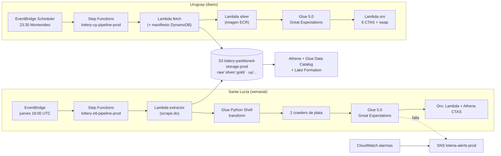

# Angels-Design-Review-Guide

**Fecha:** 2026-11-23 · **Autor:** Angel Hernandez · **Estado del sistema revisado:** `master` en `9bae0551`

Una guía para revisar con tus propias manos cada parte del proyecto, desde la fuente de los datos
hasta el CI. La idea es que puedas defender cada decisión como si fuera tu tesis y llegar
preparado a la charla de AWS y a la fase de ML. No es una explicación del sistema: es el examen.
Cada parada termina con las preguntas que tienes que poder contestar sin mirar.

## Contenido

- [Cómo usar esta guía](#cómo-usar-esta-guía)
- [Mapa del sistema](#mapa-del-sistema)
- [Parada 1 — Las fuentes](#parada-1--las-fuentes)
- [Parada 2 — Los scrapers y la extracción](#parada-2--los-scrapers-y-la-extracción)
- [Parada 3 — El data lake en S3](#parada-3--el-data-lake-en-s3)
- [Parada 4 — La transformación a plata](#parada-4--la-transformación-a-plata)
- [Parada 5 — Calidad de datos](#parada-5--calidad-de-datos)
- [Parada 6 — Oro y Athena](#parada-6--oro-y-athena)
- [Parada 7 — Orquestación](#parada-7--orquestación)
- [Parada 8 — Observabilidad](#parada-8--observabilidad)
- [Parada 9 — Seguridad e IAM](#parada-9--seguridad-e-iam)
- [Parada 10 — Terraform](#parada-10--terraform)
- [Parada 11 — Empaquetado y contenedores](#parada-11--empaquetado-y-contenedores)
- [Parada 12 — CI/CD y calidad del código](#parada-12--cicd-y-calidad-del-código)
- [Parada 13 — Costos](#parada-13--costos)
- [Las decisiones que tienes que poder defender](#las-decisiones-que-tienes-que-poder-defender)
- [Preguntas de jurado para la charla](#preguntas-de-jurado-para-la-charla)
- [Puente a la fase de ML](#puente-a-la-fase-de-ml)
- [Registro de avance](#registro-de-avance)

---

## Cómo usar esta guía

**El método de QA, igual en cada verificación:**

1. **Afirmación.** Lo que el proyecto dice que hace (el README, el roadmap o el código).
2. **Verificación.** Cómo lo compruebas tú: un comando de solo lectura, una consulta, abrir un
   archivo o romper algo en local.
3. **Evidencia.** Lo que viste, con fecha. Una captura o la salida del comando.
4. **Justificación.** Por qué se hizo así y qué alternativa se descartó. Si no la puedes
   explicar, esa es la pregunta que tienes que traerme.

**Reglas de seguridad mientras revisas:**

- **Solo lectura en AWS.** Usa `list-*`, `describe-*`, `get-*`, `terraform plan` y `SELECT` en
  Athena. Nunca `apply`, `destroy`, `delete-*` ni `put-*` sin hablarlo antes.
- **En la cuenta hay recursos de otros proyectos.** No se tocan.
- **Las fuentes se miran como un visitante normal.** Nada de sondear sus servidores ni de
  avisarles de nada (decisión tuya del 2026-10-24).
- **`DET_INVALIDAS` de Uruguay nunca se abre.** Es la decisión de privacidad del proyecto.
- **Si quieres romper algo en local para probarlo, hazlo en una rama o un worktree.** `master` es
  desde donde despliegas.
- Antes de cada sesión: `export AWS_PROFILE=<tu-perfil> AWS_REGION=us-east-1`.

**Cómo leer cada parada:** primero la afirmación que tienes que poder defender, después la lista
de verificaciones (`- [ ]`, márcalas al hacerlas) y al final las preguntas de jurado de esa
parada. Las rutas son relativas a la raíz del repositorio. Anota tus hallazgos en
[`Angels-notes.md`](Angels-notes.md) o debajo de cada parada.

---

## Mapa del sistema

Hay dos pipelines en la misma cuenta, el mismo bucket de datos y el mismo repositorio. Siguen el
mismo patrón medallion (raw o bronce → plata → oro), pero cada uno se decidió por separado. Ahí
está la mitad de las preguntas de jurado: ¿por qué no son iguales?



Leído de la cuenta el 2026-11-23:

| Pieza | Santa Lucía (Guatemala) | DNLQ (Uruguay) |
| --- | --- | --- |
| Fuente | `loteria.org.gt`, a través del proxy scrape.do (`geoCode=GT`, `super=true`) | `www.loteria.gub.uy`, directo, con un cliente cortés (1 petición por segundo, User-Agent que se identifica) |
| Disparador | Regla de EventBridge `lottery-etl-weekly-trigger-prod`, `cron(0 18 ? * THU *)` | EventBridge Scheduler `lottery-uy-nightly-prod`, 23:30 `America/Montevideo` |
| Máquina de estados | `lottery-etl-pipeline-prod` | `lottery-uy-pipeline-prod` |
| Extracción | Lambda `lottery-extractor-prod` (zip + layer) | Lambda `lottery-uy-fetch-prod` (zip) + manifiesto en DynamoDB `lottery-uy-manifest-prod` |
| Plata | Glue Python Shell `lottery-transform-prod` (Glue 3.0, Python 3.9) + 2 crawlers de plata | Lambda `lottery-uy-silver-prod` (imagen de ECR, 2048 MB) |
| Calidad | Glue 5.0 `loteria-silver-dq-prod` (Great Expectations) | Glue 5.0 `lottery-uy-silver-dq-prod` (Great Expectations) |
| Oro | `PrepGold` → `BuildGold` (Map) con la Lambda `lottery-gold-purge-prod` + CTAS de Athena | Lambda `lottery-uy-gold-prod`: 6 CTAS y swap atómico |
| Catálogo y Athena | `lottery_santalucia_db`, workgroup `lottery-wg` | `lottery_uy_db`, workgroup `lottery-uy-wg` |
| Datos en S3 | `lottery-partitioned-storage-prod`: `raw/`, `silver/`, `gold/` | El mismo bucket, bajo el prefijo `uy/` |
| Código desplegado | `lambda-code-zip-prod` | El mismo bucket, bajo `uy/` + el repo de ECR `lottery-uy-silver-prod` |
| Terraform | Stack principal `terraform/` (estado `main/`) | Stack propio `terraform/uy/` (estado `uy/`) |
| Alertas | Tópico SNS `loteria-alerts-prod` (compartido) | El mismo tópico |

Además, la Lambda `lottery-object-count-prod` corre cada hora y cuenta objetos en S3 (parada 8).

**Lo que ves en la cuenta y NO es de este proyecto:** los recursos de este proyecto llevan
`lottery` o `loteria` en el nombre (más el bucket de código `lambda-code-zip-prod`). Ignora el
resto en cada parada.

**Orden sugerido:** sigue el camino del dato. Haz las paradas 1 a 8 primero con Santa Lucía y
después con Uruguay; las paradas 9 a 13 son transversales.

- [ ] Comprueba que la tabla sigue siendo cierta: `aws stepfunctions list-state-machines`,
  `aws lambda list-functions`, `aws glue get-jobs`, `aws glue get-crawlers`,
  `aws scheduler list-schedules` y `aws events list-rules`.
- [ ] Abre [`layouts/diagram.html`](layouts/diagram.html) y
  [`layouts/diagram-uruguay.html`](layouts/diagram-uruguay.html) en el navegador y compáralos con
  la tabla.
- [ ] Hallazgo para investigar: `aws glue get-crawlers` muestra 4 crawlers, no 2. ¿Qué son
  `lottery-premios-crawler` y `lottery-sorteos-crawler`, y por qué siguen ahí? (Pista: busca
  `processed/` en [`roadmap.md`](roadmap.md) y en la memoria del refactor.)

---

## Parada 1 — Las fuentes

**Lo que tienes que poder defender:** los datos salen de los sitios oficiales de los operadores,
se piden con cortesía y lo publicado se guarda tal cual (bronce) antes de interpretarlo. Las dos
fuentes son muy distintas, y por eso los scrapers también lo son.

**Santa Lucía (`loteria.org.gt`)**

- [ ] Abre `https://loteria.org.gt/site/award` en el navegador. Es la página de la que parte el
  extractor ([`src/loteria/extractor/scraping.py`](src/loteria/extractor/scraping.py), función
  `extract_lottery_data`). Encuentra el link de un sorteo y el bloque
  `div.lista-premios-columnas`, que es donde viven los premios.
- [ ] Compara un sorteo que veas en el sitio con lo que hay en `raw/` del bucket y en
  `silver_premios_premios` en Athena: el mismo número de sorteo, los mismos premios y los mismos
  vendedores.
- [ ] Entiende por qué hace falta el proxy scrape.do. El sitio está detrás de Cloudflare y solo
  funciona desde IPs residenciales de Guatemala; una IP de AWS es rechazada. Lee los comentarios
  de `scraping.py` (líneas 27 a 50): el perfil del proxy ya cambió dos veces, y hoy es
  `geoCode=GT&super=true` sin `render`.
- [ ] Lee [`docs/challenges.md`](docs/challenges.md) para ver las veces que la fuente cambió o
  bloqueó.
- [ ] Ten clara la diferencia: `prociegosysordos.org.gt` es la organización madre, no un espejo,
  y muestra menos de lo que guardamos.
- [ ] **Pendiente (2026-11-25): cruzar los calendarios oficiales con plata.** Santa Lucía publica
  cada año una imagen con el calendario de sorteos (fecha, tipo, número y premio mayor):
  [`images/listado_sorteos_2024.jpg`](images/listado_sorteos_2024.jpg),
  [`images/listado_sorteos_2025.jpg`](images/listado_sorteos_2025.jpg) y
  [`images/listado_sorteos_2026.jpg`](images/listado_sorteos_2026.jpg). Son la única forma de
  comprobar que no falta ningún sorteo; antes de 2024 no hay calendario ni archivo en internet.
    - Pasa cada imagen a una lista (fecha, tipo, número). Rangos leídos de las imágenes: 2024,
      ordinarios 3031–3069 y extraordinarios 385–395; 2026, ordinarios 3109–3148 y extraordinarios
      407–417. Los de 2025 deberían ser 3070–3108 y 396–406: confírmalo con su imagen.
    - Compáralo con plata:

      ```sql
      SELECT tipo_sorteo, numero_sorteo, fecha_sorteo
      FROM lottery_santalucia_db.silver_sorteos_sorteos
      WHERE year IN ('2024', '2025', '2026')
      ORDER BY tipo_sorteo, numero_sorteo;
      ```

    - Anota tres cosas: los sorteos del calendario que no están en plata, los que tienen otra
      fecha que la del calendario y los que están en plata pero no en el calendario. Los
      sorteos de diciembre de 2026 que todavía no se jugaron no cuentan como faltantes.
    - Ojo con el tipo de `year`. Si es `string` (partición), van entre comillas; si la consulta
      falla, revísalo con `DESCRIBE`.
    - **Mejora que sale de aquí (idea del 2026-11-25):** un manifiesto para Santa Lucía, como
      el de Uruguay. Una vez al año se pasa el calendario oficial a un archivo (unas 52 filas,
      como `calendar_events.csv` en Uruguay) y ese archivo es la lista de lo que debería
      existir. Cada corrida compara contra él y avisa si falta un sorteo **mientras todavía está
      en el sitio**, que solo muestra los más recientes: pasado ese margen, el sorteo se pierde
      para siempre. Decídelo después del cruce, con los números en la mano.

**DNLQ (`www.loteria.gub.uy`)**

- [ ] Abre `/ver_resultados.php?vdia=20&vmes=11&vano=2026`. Es una página por día con todos los
  juegos de ese día (la fuente `resultados` de
  [`src/sorteos/uy/site.yaml`](src/sorteos/uy/site.yaml)).
- [ ] Lee [`src/sorteos/uy/games/5_de_oro.yaml`](src/sorteos/uy/games/5_de_oro.yaml). Un juego
  tiene una fuente primaria (HTML), un extracto de control (PHP), un PDF de respaldo y el PDF de
  pozos, que da el número de sorteo. Explica el papel (`role`) de cada una.
- [ ] Busca en [`docs/uruguay/FINDINGS.md`](docs/uruguay/FINDINGS.md) los hallazgos que cambiaron
  el diseño:
    - el 5 de Oro no siempre cae miércoles y domingo (el 12,6 % se mueve);
    - qué devuelve una fecha sin sorteo;
    - los 4 días `error` del paro de 2019;
    - los errores de tipeo de 2006.
- [ ] Comprueba la decisión de privacidad sin abrir nada. En
  [`src/sorteos/uy/privacy.py`](src/sorteos/uy/privacy.py), `DET_INVALIDAS` está bloqueado en el
  cliente HTTP, así que no se pide ni se sigue en una redirección. Busca los tests que lo
  prueban, por ejemplo en `tests/unit/sorteos/test_uy_lambda_fetch.py`.
- [ ] Explica la diferencia de modelo. En Guatemala se baja el sorteo nuevo una vez por semana.
  En Uruguay se mantiene un calendario de qué páginas deberían existir y se pregunta por cada una
  (el manifiesto, parada 2).

**Preguntas de jurado**

- ¿Qué pasa si mañana el sitio cambia su HTML? ¿Quién se entera primero y cómo?
- ¿Es legal y ético scrapear estos sitios? ¿Qué hiciste para ser un buen visitante?
- ¿Por qué Uruguay no necesita proxy y Guatemala sí?
- ¿Cómo sabes que no te falta ningún sorteo?

---

## Parada 2 — Los scrapers y la extracción

**Lo que tienes que poder defender:** la extracción es idempotente (correrla dos veces no
duplica nada), reintenta solo lo que vale la pena reintentar y nunca filtra el token del proxy.
En Uruguay, además, cada petición queda registrada en un manifiesto que dice qué se pidió, cuándo
y qué devolvió.

**Santa Lucía: [`src/loteria/extractor/`](src/loteria/extractor/)**

- [ ] Lee `lambda_handler.py` de punta a punta. Contesta: ¿cómo sabe qué sorteos ya tiene? (Se
  salta los que ya están en plata.) ¿Dónde escribe? (`raw/year=<YYYY>/sorteo=<N>/`, un `.txt` por
  sorteo.)
- [ ] Encuentra en `scraping.py` qué códigos se reintentan (`is_retryable_status`) y con qué
  esperas. Según el README, los errores del proxy (429, 5xx) se reintentan a los 5, 15 y 35
  minutos. La espera no está en la Lambda: es un `Retry` de la máquina de estados sobre
  `ProxyRetryableError` (300 s, 3 intentos, backoff 2,0). Encuéntralo en la definición y explica
  por qué es mejor que dormir dentro de la Lambda. Ver
  [`docs/runbooks/PR-047-extractor-proxy-retry.md`](docs/runbooks/PR-047-extractor-proxy-retry.md).
- [ ] Busca `_scrubbed` en `scraping.py` y explica por qué existe. Un `ConnectionError` de
  `requests` incluye la URL completa, token incluido, y antes terminaba en los logs (PR-051).
- [ ] Encuentra de dónde sale el token: el secreto del proyecto en Secrets Manager,
  leído por [`src/loteria/common/aws_secrets.py`](src/loteria/common/aws_secrets.py). Verifica
  que existe con `aws secretsmanager list-secrets`. **No lo leas con `get-secret-value`.**
- [x] **Rotar el token de scrape.do (hecho el 2026-11-26).** Es higiene: deja inútil
  cualquier copia vieja. Es una escritura en AWS, así que hazla a propósito y no a mitad de
  otra revisión. El mejor momento es el jueves, justo después de que la corrida termine en
  verde: es cuando más lejos estás del próximo uso (el canario del miércoles siguiente).
    1. Genera un token nuevo en el panel de scrape.do y guárdalo en un archivo temporal fuera
       del repo. Antes de usarlo, compruébalo gratis con el endpoint `/info` de scrape.do
       (`IsActive: true`).
    2. Actualiza **solo** la llave `scrape_do_token` del secreto en Secrets Manager. El secreto
       es un JSON con otras llaves, así que no lo reemplaces entero: arma el JSON nuevo con
       `jq --rawfile`, compara llaves y largos sin mostrar valores y recién entonces corre
       `put-secret-value`. El token nunca va escrito en el comando, para que no quede en el
       historial de la shell. La versión anterior queda como `AWSPREVIOUS` por si hay que
       volver atrás.
    3. Actualiza el secreto `SCRAPE_DO_TOKEN` del repo en GitHub, desde la interfaz web
       (editando el existente, con el nombre exacto).
    4. Comprueba los dos caminos: corre el canario a mano (`workflow_dispatch`, unos 20
       créditos) y mira que la corrida del jueves salga verde. El extractor lee el secreto al
       arrancar, así que un contenedor que siga vivo usaría el token viejo hasta reciclarse.
    5. Confirma que el token viejo ya no sirve: el `/info` de scrape.do responde HTTP 200 pero
       con `IsActive: false` y 0 créditos (no un 401).
    6. Borra los archivos temporales.

  Trampas que aparecieron: un `.sh` sin shebang lo ejecuta `/bin/sh` (dash), que no entiende
  `<<<`; córrelo con `bash`. El `(END)` en la salida de `aws` es el paginador
  (`export AWS_PAGER=""` lo apaga).
- [ ] **Pendiente: confirmar que la corrida del jueves 2026-12-03 sale verde con el token
  nuevo.** Es la primera vez que la Lambda lo usa; el canario manual ya probó el camino de
  GitHub (15 tests pasaron).
- [ ] Mira una corrida real: `aws stepfunctions list-executions` sobre
  `lottery-etl-pipeline-prod` y, en la consola, el input y el output del paso
  `RunExtractorLambda`.

**Uruguay: [`src/sorteos/`](src/sorteos/)**

- [ ] Entiende la división `core/` (sin país) frente a `uy/` (decisión D1 de
  [`docs/uruguay/DESIGN.md`](docs/uruguay/DESIGN.md)). ¿Qué haría falta para agregar un tercer
  país?
- [ ] Lee [`src/sorteos/core/http_client.py`](src/sorteos/core/http_client.py): un mínimo de 1 s
  entre peticiones (no se puede bajar), un User-Agent que se identifica y backoff con jitter en
  429 y 5xx.
- [ ] Lee [`src/sorteos/uy/classify.py`](src/sorteos/uy/classify.py) y la decisión D8. Ubica los
  cinco estados del manifiesto (`draw`, `no_draw`, `not_yet_published`, `missing`, `error`) y
  explica qué lleva una página a cada uno.
- [ ] Lee el docstring de [`src/sorteos/uy/incremental.py`](src/sorteos/uy/incremental.py). Cada
  noche se vuelven a pedir los últimos 7 días (3 de *settle*, 3 del detector de huecos y 1 más).
  Además se vuelven a pedir, hasta 14 días, las páginas del 5 de Oro que todavía no enlazan su
  PDF de pozos.
- [ ] Mira el manifiesto real (solo lectura, filas acotadas):

  ```bash
  aws dynamodb scan --table-name lottery-uy-manifest-prod --max-items 5
  ```

  Distingue las filas `LOG#…` (cada petición) de la fila de estado de cada clave.
- [ ] Reproduce una verificación que hicimos para G4: en una misma corrida, ninguna clave se
  pidió dos veces. ¿Cómo lo comprobarías tú con el manifiesto?

**Preguntas de jurado**

- ¿Por qué un manifiesto en DynamoDB y no "listar S3 y ver qué falta"?
- ¿Qué pasa si la Lambda muere a mitad de la corrida?
- ¿Por qué tu scraper de Guatemala reintenta a los 5, 15 y 35 minutos y no al segundo?
- ¿Cómo demuestras que el token del proxy no aparece en ningún log?

---

## Parada 3 — El data lake en S3

**Lo que tienes que poder defender:** un solo bucket de datos con capas por prefijo. El dato
crudo nunca se pisa, y nadie más que root y dos roles puntuales puede borrar.

- [ ] Recorre el bucket: `aws s3 ls s3://lottery-partitioned-storage-prod/` y luego `raw/`,
  `silver/`, `gold/` y `uy/`. Explica el esquema de particiones de cada capa (`year=`,
  `sorteo=`, `country=`, `game=`, `run=`).
- [ ] Lee la política del bucket:

  ```bash
  aws s3api get-bucket-policy --bucket lottery-partitioned-storage-prod --query Policy --output text | python3 -m json.tool
  ```

  Hay dos `Deny`: `Phase0DenyDeleteExceptRoot` y `UyGoldDeletesOnlyUnderUyGold`. Explica a quién
  exceptúa cada una y por qué ni siquiera `AdministratorAccess` puede borrar.
- [ ] El versionado del bucket de datos está `Enabled`
  (`aws s3api get-bucket-versioning --bucket lottery-partitioned-storage-prod`). Explica qué
  consecuencia tuvo eso para borrar generaciones viejas de oro (borrar versiones, no solo
  objetos; ver
  [`docs/runbooks/PR-042.2-retire-generations.md`](docs/runbooks/PR-042.2-retire-generations.md)).
- [ ] Compara con el bucket de código `lambda-code-zip-prod`, versionado desde hoy (PR-054):
  versionado, bloqueo de acceso público y una regla que expira versiones viejas a los 90 días.
- [ ] Explica por qué hubo un "bucket simple" y por qué se retiró
  ([`docs/runbooks/PR-041-retire-simple-bucket.md`](docs/runbooks/PR-041-retire-simple-bucket.md)).
- [ ] Lake Formation:

  ```bash
  aws lakeformation list-resources
  ```

  Hoy hay ubicaciones registradas para `silver/` y `uy/silver/`, pero también para `processed/`.
  ¿Siguen haciendo falta las de `processed/`? Anótalo como hallazgo, no lo cambies.
- [ ] Glue Data Catalog: `aws glue get-tables --database-name lottery_santalucia_db` y lo mismo
  con `lottery_uy_db`. ¿Cuáles tablas declara Terraform y cuáles crea un crawler o un CTAS?

**Preguntas de jurado**

- ¿Por qué un bucket con prefijos y no un bucket por capa?
- Si alguien con permisos de administrador borra `silver/` por error, ¿qué pasa?
- ¿Para qué Lake Formation, si ya tienes IAM?
- ¿Por qué Parquet y no CSV o JSON en plata?

---

## Parada 4 — La transformación a plata

**Lo que tienes que poder defender:** la plata es la fuente de verdad. Está tipada, tiene linaje
(qué corrida y qué archivo de origen produjo cada fila) y una fila que no se puede leer no se
pierde: va a cuarentena.

**Santa Lucía**

- [ ] Lee [`src/loteria/transformer/transformer.py`](src/loteria/transformer/transformer.py) y
  [`src/loteria/parser/parser.py`](src/loteria/parser/parser.py). Sigue un archivo de `raw/`
  hasta sus filas en `silver/sorteos/` y `silver/premios/`.
- [ ] Explica por qué el transform corre en Glue Python Shell y no en Lambda
  ([`docs/challenges.md`](docs/challenges.md), sección 7: pandas y pyarrow no entraban cómodos
  en un paquete de Lambda). Explica también por qué ese job sigue en Python 3.9
  (Python Shell no pasa de 3.9).
- [ ] Encuentra las columnas de linaje (`run_id`, `ingested_at`) en una consulta de Athena y
  sigue un `run_id` hasta su ejecución de Step Functions
  ([`docs/runbooks/PR-045.1-lineage-columns.md`](docs/runbooks/PR-045.1-lineage-columns.md)).
- [ ] Lee [`docs/runbooks/PR-044.2-quarantine-store.md`](docs/runbooks/PR-044.2-quarantine-store.md)
  y mira `quarantine/` en el bucket. ¿Qué clases de rechazo existen y cuál dispara una alarma?
- [ ] Entiende por qué el esquema de plata está en Terraform y no lo decide el crawler
  ([`docs/runbooks/PR-045.2-lineage-queryable.md`](docs/runbooks/PR-045.2-lineage-queryable.md)).
  Un crawler no puede evolucionar el esquema por tres ajustes que se combinan.

**Uruguay**

- [ ] Lee [`src/sorteos/core/silver.py`](src/sorteos/core/silver.py): los esquemas de las 7
  tablas (`draws`, `draw_numbers`, `prizes`, `game_rules`, `calendar_events`, `draw_gaps`,
  `quarantine`).
- [ ] Explica por qué la Lambda de plata es una imagen de contenedor (las dependencias pesan
  unos 222 MB, más que el límite de un zip) y la de fetch es un zip (decisión D29).
- [ ] Explica D17: cada corrida reescribe entera la partición de cada año que tocó. ¿Por qué eso
  es más simple y seguro que un append?
- [ ] Busca `dq_flags` en plata. Un ejemplo real: los sorteos 2924 a 2926 del 5 de Oro tienen
  `draw_number_inferred` porque su PDF de pozos nunca se publicó.
- [ ] Trampa de tipos: lee la memoria sobre Parquet frente al catálogo de Glue. Una columna toda
  `None` se escribe con el tipo Parquet `Null`, y un `int` de Python llega como `int64`. ¿Dónde
  se previene eso hoy?

**Preguntas de jurado**

- ¿Qué pasa si el parser se encuentra con un formato nuevo?
- ¿Por qué Glue para Guatemala y Lambda para Uruguay?
- ¿Cómo sabes qué versión del parser produjo cada fila?

---

## Parada 5 — Calidad de datos

**Lo que tienes que poder defender:** la calidad se controla en dos niveles, fila por fila en el
transform y el conjunto completo en Great Expectations. Si el gate falla, el oro no se
reconstruye y el de la semana anterior sigue publicado.

- [ ] Lee [`src/loteria/dq/suites.py`](src/loteria/dq/suites.py). Son 29 expectativas sobre las
  dos tablas de Santa Lucía, incluida la integridad referencial (cada premio apunta a un sorteo
  que existe). Compara con los JSON generados en [`qa/great_expectations/`](qa/great_expectations/).
- [ ] Encuentra el test que falla si el código y los JSON se separan.
- [ ] Corre el gate desde tu laptop, solo lectura:
  `make dq PARTITIONED_BUCKET=lottery-partitioned-storage-prod`.
- [ ] Lee [`docs/runbooks/PR-033-dq-gate.md`](docs/runbooks/PR-033-dq-gate.md): el gate se probó
  en los dos sentidos en producción (pasa con datos buenos y bloquea con datos malos). ¿Cómo se
  probó el bloqueo sin romper nada?
- [ ] Explica por qué GX corre en Glue 5.0 (Spark) aunque no use Spark: GX 1.x necesita
  Python 3.11 y Python Shell no pasa de 3.9. Mira la duración de una corrida del job
  `lottery-uy-silver-dq-prod` (`aws glue get-job-runs`).
- [ ] El canario del scraper:
  [`.github/workflows/scraper-canary.yml`](.github/workflows/scraper-canary.yml) corre cada
  miércoles, 24 horas antes de la corrida real. ¿Qué comprueba y qué hace si falla?
- [ ] Uruguay: lee las suites de [`src/sorteos/uy/dq/`](src/sorteos/uy/dq/) y la tabla
  `draw_gaps`. Explica la regla combinada D14 (el anuncio "Próximo sorteo" más el calendario del
  juego) para detectar sorteos faltantes.
- [ ] Reconciliación: `make uy-reconcile` cruza los días hábiles del calendario con lo que hay
  en plata. Lee qué hace antes de correrlo.

**Preguntas de jurado**

- ¿Por qué las expectativas se perfilaron con los datos reales y no se inventaron?
- ¿Qué diferencia hay entre una fila en cuarentena, un `dq_flag` y una expectativa que falla?
- Si el gate bloquea por error un jueves, ¿qué haces?

---

## Parada 6 — Oro y Athena

**Lo que tienes que poder defender:** el oro se reconstruye entero en cada corrida. Se construye
al lado del publicado y se cambia de una vez, así que nadie ve un oro a medias. Reconstruirlo
entero es más barato que hacerlo incremental, y está medido.

- [ ] Lee el SQL de [`sql/gold/`](sql/gold/) (7 tablas de Santa Lucía) y
  [`sql/uy/gold/`](sql/uy/gold/) (6 de Uruguay). Corre una en Athena, en el workgroup que
  corresponde, y explica qué responde.
- [ ] Lee [`src/sorteos/core/gold.py`](src/sorteos/core/gold.py). Construye las 6 tablas como
  `stg_gold_*`, cuenta filas y solo entonces hace el swap con `UpdateTable` (D35). ¿Qué pasa si
  una de las 6 sale vacía?
- [ ] Comprueba la retención: en `uy/gold/<tabla>/` quedan siempre dos generaciones (`run=`), la
  viva y la anterior. Míralo con `aws s3 ls`.
- [ ] Lee [`sql/gold/README.md`](sql/gold/README.md) y la memoria sobre el piso de 10 MiB de
  Athena. Reconstruir todo escanea 4,84 MiB, pero Athena cobra como mínimo 10 MiB por consulta.
  Por eso un oro incremental costaría más, no menos.
- [ ] Lee los tres arreglos de permisos que necesitó el swap del oro en
  [`docs/runbooks/PR-042.3-gold-purge-alter-grant.md`](docs/runbooks/PR-042.3-gold-purge-alter-grant.md)
  y [`docs/runbooks/PR-042.4-partition-iam-actions.md`](docs/runbooks/PR-042.4-partition-iam-actions.md).
- [ ] Workgroups: `aws athena get-work-group --work-group lottery-uy-wg`. Mira el tope de bytes
  escaneados por consulta y dónde se guardan los resultados.

**Preguntas de jurado**

- ¿Qué ve un usuario de Athena si consulta justo durante el swap?
- ¿Por qué CTAS y no Glue ETL o dbt?
- ¿Cómo vuelves atrás si el oro nuevo sale mal?

---

## Parada 7 — Orquestación

**Lo que tienes que poder defender:** cada pipeline es una máquina de estados con pasos
síncronos (`.sync`). Una falla en cualquier paso es la falla de la ejecución, con alarma.
Uruguay tiene además un modo dry run que no escribe nada.

- [ ] Descarga y lee las dos definiciones:

  ```bash
  aws stepfunctions describe-state-machine --state-machine-arn "$(aws stepfunctions list-state-machines --query "stateMachines[?name=='lottery-uy-pipeline-prod'].stateMachineArn" --output text)" --query definition --output text | python3 -m json.tool
  ```

  Santa Lucía: `RunExtractorLambda` → `RunTransformerGlueJob` → `RunSilverCrawlers` →
  `RunSilverDQ` → `PrepGold` → `BuildGold`. Uruguay: `Defaults` → `CheckInput` → `Fetch` →
  `Silver` → `ValidateSilver` → `GoldUnlessDryRun` → `BuildGold`.
- [ ] Compara los disparadores: una regla de EventBridge con cron en UTC (Santa Lucía) frente a
  EventBridge Scheduler con zona horaria (Uruguay, D27). ¿Por qué el segundo resuelve el cambio
  de horario?
- [ ] Lee la memoria sobre el polling del crawler. `startCrawler` no tiene `.sync`, y esperar a
  que `State == READY` no alcanza porque puede ser un READY viejo. Por eso se usa
  `LastCrawl.MessagePrefix`. Ubícalo en la definición de Santa Lucía.
- [ ] Mira el historial de una ejecución en la consola y sigue el `run_id` hasta los logs de cada
  paso.
- [ ] Lee cómo se lanza un dry run de Uruguay (`make uy-sfn-run`) y qué se salta. **No lo corras
  sin hablarlo**: también le pide páginas al sitio.

**Preguntas de jurado**

- ¿Por qué Step Functions y no Airflow (MWAA)?
- ¿Qué pasa si dos ejecuciones se pisan?
- ¿Por qué Guatemala corre una vez por semana y Uruguay todas las noches?

---

## Parada 8 — Observabilidad

**Lo que tienes que poder defender:** hay alarmas para lo que falla y también para lo que "sale
bien" pero no debería: una noche sin datos, un sorteo que falta, filas en cuarentena. Son 14
alarmas en total (9 de Santa Lucía y 5 de Uruguay) y todas van a un mismo tópico SNS.

- [ ] Lista las alarmas y su estado:

  ```bash
  aws cloudwatch describe-alarms --query "MetricAlarms[?contains(AlarmName,'loteria') || contains(AlarmName,'lottery')].[AlarmName,StateValue]" --output table
  ```

- [ ] Abre el dashboard `loteria-pipeline-prod` en CloudWatch y explica cada widget.
- [ ] Explica el dead-man: `lottery-uy-pipeline-prod-no-success-2d` alarma si NO hay dato (una
  noche que no corrió). En cambio, las alarmas de métricas propias no alarman sin dato. Lee
  [`docs/runbooks/UY-045-alarmas.md`](docs/runbooks/UY-045-alarmas.md) y la memoria sobre las
  trampas de las alarmas: 0 no es lo mismo que "sin dato", y la evaluación tiene un tope de
  7 días.
- [ ] Métricas EMF: las Lambdas de Uruguay publican sus cuentas como una línea de log (namespace
  `Loteria/UY`), sin `PutMetricData`. Busca esa línea en los logs de `lottery-uy-fetch-prod`.
- [ ] `lottery-object-count-prod`: lee [`docs/runbooks/PR-027-object-count.md`](docs/runbooks/PR-027-object-count.md).
  Mide el activo (cuántos objetos hay), no la ejecución: una corrida verde que no agregó nada
  solo se ve como una línea plana.
- [ ] Retención de logs: cada grupo de logs está declarado en Terraform con su retención
  ([`docs/runbooks/PR-023-log-retention.md`](docs/runbooks/PR-023-log-retention.md)).
- [ ] Confirma que te llega el correo: el tópico `loteria-alerts-prod` y su suscripción
  ([`docs/runbooks/PR-028-alert-email.md`](docs/runbooks/PR-028-alert-email.md)).

**Preguntas de jurado**

- ¿Cómo te enteras de que el pipeline no corrió, si no hubo error?
- ¿Por qué EMF y no `PutMetricData`?
- ¿Cuántas alarmas falsas tuviste y qué cambiaste por eso?

---

## Parada 9 — Seguridad e IAM

**Lo que tienes que poder defender:** cada componente tiene su propio rol con lo mínimo. Ningún
secreto está en el código, el borrado de datos está cerrado por una política explícita y la
cuenta compartida está aislada por nombres y permisos.

- [ ] Para cada Lambda, lee su rol y sus políticas:

  ```bash
  aws lambda get-function-configuration --function-name lottery-uy-gold-prod --query Role
  aws iam list-role-policies --role-name <rol>
  aws iam get-role-policy --role-name <rol> --policy-name <política>
  ```

  Comprueba que los recursos están acotados (prefijos de S3, tablas de Glue, un workgroup).
- [ ] Lake Formation: `aws lakeformation list-permissions --resource '{"Database":{"Name":"lottery_uy_db"}}'`.
  Explica por qué una lectura necesita las dos cosas, el grant de LF y el permiso IAM
  `lakeformation:GetDataAccess`, y por qué nunca se usa `ALL`.
- [ ] Lee la auditoría de seguridad del 2026-10-24. En el roadmap están PR-051 (el token en los
  logs), PR-052 (se quitó SageMaker con `FullAccess`), PR-053 (Actions fijadas por SHA) y PR-054
  (el bucket de código).
- [ ] Explica por qué el pipeline corre fuera de la VPC
  ([`vpc-separation.md`](vpc-separation.md)) y por qué el módulo `network` sigue existiendo con
  el NAT apagado.
- [ ] Busca secretos en el repo: `git grep -n "token=" -- src/` y los hooks de bandit y Trivy del
  CI (parada 12).

**Preguntas de jurado**

- ¿Qué puede hacer un atacante que robe el rol de la Lambda de fetch?
- ¿Por qué no hay KMS propio en los buckets? (Pista: el baseline de checkov lo deja anotado.)
- ¿Por qué no separaste dev y prod en dos cuentas?

---

## Parada 10 — Terraform

**Lo que tienes que poder defender:** toda la infraestructura está en código, en dos stacks con
estados separados. El estado vive en S3 con lock en DynamoDB, y lo que existía antes se importó,
no se recreó.

- [ ] Lee [`terraform/main.tf`](terraform/main.tf) y recorre los módulos de
  [`terraform/modules/`](terraform/modules/): `storage`, `network`, `iam`, `etl-lambda`,
  `etl-glue`, `catalog`, `orchestration`, `lake-formation` y `observability`.
- [ ] Lee [`terraform/uy/backend.tf`](terraform/uy/backend.tf). Explica por qué nunca se
  inicializa con `../backend.hcl`: ese archivo fija `key = main/...`, pisa la key del stack y el
  plan querría destruir todo.
- [ ] El estado: bucket `loteria-tf-state-<account-id>`, tabla de lock `loteria-tf-locks`. Lee
  [`terraform/bootstrap/README.md`](terraform/bootstrap/README.md). ¿Por qué el bootstrap tiene
  su propio estado local?
- [ ] Corre los dos planes y comprueba que dan `No changes`:
  - `make tf-plan` para el stack principal;
  - `make uy-tf-plan` para Uruguay.

  Antes, revisa que tu shell no tenga `umask 077`: cambia los hashes de los zips y el plan sale
  con cambios falsos.
- [ ] Imports: lee
  [`docs/runbooks/PR-004-state-migration.md`](docs/runbooks/PR-004-state-migration.md) y
  [`docs/runbooks/PR-005-bucket-import.md`](docs/runbooks/PR-005-bucket-import.md). El estado
  original se perdió y se reconstruyó con `import`.
- [ ] Usa `terraform state list | wc -l` y `terraform state show <recurso>` para comparar un
  recurso del código con lo que hay en AWS.
- [ ] checkov: lee [`terraform/.checkov.baseline`](terraform/.checkov.baseline). Cada hallazgo
  aceptado tiene una razón. Elige tres y explica por qué se aceptaron.
- [ ] El cambio fantasma conocido: agregar algo a `module.iam` le da a `gold_purge` un cambio de
  plan falso (la memoria sobre data sources diferidos). Entiende por qué.

**Preguntas de jurado**

- ¿Por qué dos stacks y no uno?
- ¿Qué pasa si dos personas corren `apply` al mismo tiempo?
- ¿Cómo sabes que nadie cambió algo a mano en la consola?

---

## Parada 11 — Empaquetado y contenedores

**Lo que tienes que poder defender:** los artefactos se construyen igual byte a byte desde el
mismo código. Por eso un plan sin cambios de código da `No changes`, y el CI lo comprueba.

- [ ] Lee los scripts de [`scripts/`](scripts/) que usa `make build`:
  `build_lambda_layer.sh`, `build_lambda_function.sh`, `build_glue_package.sh` y
  `build_dq_package.sh`.
- [ ] Prueba la reproducibilidad: corre `make build` dos veces y compara con
  `sha256sum dist/* terraform/*.zip`.
- [ ] Lee los locks de [`requirements/`](requirements/) y explica por qué las versiones van
  fijadas (las dependencias transitivas sin fijar reemplazaban la layer cualquier día).
- [ ] Imagen de ECR: lee [`docker/uy-silver/`](docker/uy-silver/). El repo
  `lottery-uy-silver-prod` tiene tags inmutables y escaneo al hacer push
  (`aws ecr describe-images --repository-name lottery-uy-silver-prod`).
- [ ] Glue y las wheels: el job de GX de Uruguay instala desde un zip de wheels con
  `--no-index --no-deps`. Antes, `--additional-python-modules` desde PyPI se comía unos 21 de los
  30 minutos del job. Ver [`docs/runbooks/PR-033-dq-gate.md`](docs/runbooks/PR-033-dq-gate.md) y
  la memoria sobre el techo de Python en Glue.
- [ ] Mira qué hay en el bucket de código:
  `aws s3api list-object-versions --bucket lambda-code-zip-prod --max-items 20`. Desde hoy, cada
  `make deploy` que cambie un artefacto deja la versión anterior.

**Preguntas de jurado**

- ¿Por qué una layer para el extractor y una imagen para la plata de Uruguay?
- ¿Cómo vuelves a la versión de ayer de una Lambda?
- ¿Qué pasa si PyPI se cae el día del deploy?

---

## Parada 12 — CI/CD y calidad del código

**Lo que tienes que poder defender:** ningún cambio llega a `master` sin pasar lint, tests con
98 % de cobertura mínima, validación de Terraform, escaneos de seguridad y el chequeo de build
reproducible.

- [ ] Lee [`.github/workflows/ci.yml`](.github/workflows/ci.yml). Los jobs son lint, tests,
  `terraform validate` (3 stacks), checkov, Trivy, bandit, build reproducible de la layer, la
  imagen de plata de UY y el zip de GX de UY. ¿Qué job solo corre en `master`, y por qué?
- [ ] Corre en local exactamente lo mismo que el CI: `make lint` y `make test`.
- [ ] Lee [`.pre-commit-config.yaml`](.pre-commit-config.yaml): ruff, ruff-format,
  terraform_fmt, nbstripout, end-of-file-fixer y trailing-whitespace. Ojo:
  `trailing-whitespace` puede romper los fixtures byte-exactos de Uruguay y los saltos de línea
  de Markdown.
- [ ] Mira cómo se mockea AWS en los tests (moto). Elige un test de
  [`tests/unit/`](tests/unit/) por componente y léelo.
- [ ] Lee [`.github/dependabot.yml`](.github/dependabot.yml) y explica por qué excluye
  `glue.txt` y `dq.txt` (PR-053.1).
- [ ] Comprueba que las Actions están fijadas por SHA y no por tag (PR-053).
- [ ] Haz el ejercicio de romper algo a propósito en una rama: cambia un número en una
  expectativa de GX y mira qué test falla.

**Preguntas de jurado**

- ¿Por qué no hay CD (despliegue automático desde el CI)?
- ¿Qué te da el 98 % de cobertura y qué no?
- ¿Cómo sabes que una dependencia nueva no trae una vulnerabilidad?

---

## Parada 13 — Costos

**Lo que tienes que poder defender:** el proyecto cuesta unos $3 al mes en AWS para los dos
pipelines. Es una estimación con precios públicos, no una factura. Casi todo es costo fijo
(alarmas, secretos, mínimos de facturación), no de cómputo.

| Pieza | Costo mensual aproximado (README) |
| --- | --- |
| Alarmas de CloudWatch (14 a $0,10) | $1,40 |
| Crawlers de Glue (dos por semana, mínimo de 10 minutos) | $0,60 |
| Job nocturno de GX de Uruguay (2 DPU, unos 80 s facturados) | $0,60 |
| Secrets Manager (un secreto) | $0,40 |
| Jobs semanales de Glue de Santa Lucía | $0,10 |
| Lambda, Step Functions, Athena, S3, DynamoDB | centavos |

- [ ] Compara con la factura real en Cost Explorer (filtra por servicio y separa lo que es de
  otros proyectos de la cuenta). ¿La estimación del README se sostiene?
- [ ] Mide un job: `aws glue get-job-runs --job-name lottery-uy-silver-dq-prod --max-items 5`
  y mira `ExecutionTime` y `DPUSeconds`.
- [ ] Mide Athena: en una consulta de oro, los bytes escaneados frente al mínimo de 10 MiB.
- [ ] scrape.do: unos 175 de los 1.000 créditos del plan mensual, entre la corrida semanal y el
  canario. Compruébalo en su panel.
- [ ] El NAT costaría unos $32 al mes. Comprueba que `enable_internet` vale `false`: es el
  default en [`terraform/variables.tf`](terraform/variables.tf) y `terraform.tfvars` no lo
  cambia.

**Preguntas de jurado**

- ¿Cuánto costaría con 10 veces más datos?
- ¿Qué es lo primero que apagarías para ahorrar y qué perderías?

---

## Las decisiones que tienes que poder defender

Para cada fila: explica la alternativa descartada sin mirar y encuentra tú la evidencia.

| # | Decisión | Alternativa descartada | Por qué (resumen) | Dónde está la razón |
| --- | --- | --- | --- | --- |
| 1 | El pipeline corre fuera de la VPC | Lambdas y Glue en subredes privadas con NAT | Los servicios se hablan por rutas administradas por AWS; una VPC agrega endpoints y costo sin proteger nada aquí | [`vpc-separation.md`](vpc-separation.md) |
| 2 | Glue Python Shell para el transform de Guatemala | Lambda | pandas y pyarrow no entraban cómodos en un paquete de Lambda | [`docs/challenges.md`](docs/challenges.md) §7 |
| 3 | Proxy scrape.do | Pedir directo desde AWS | Cloudflare y geobloqueo; solo funcionan IPs residenciales de Guatemala | `docs/challenges.md` §6, PR-031 |
| 4 | Oro con CTAS de Athena, reconstruido entero | Incremental | Medido: entero cuesta centavos al año; incremental pagaría más por el piso de 10 MiB | [`sql/gold/README.md`](sql/gold/README.md) |
| 5 | El gate de calidad bloquea la corrida | Solo avisar | Un aviso deja pasar datos malos al oro | [`docs/runbooks/PR-033-dq-gate.md`](docs/runbooks/PR-033-dq-gate.md) |
| 6 | Una sola cuenta de AWS | Cuentas separadas de dev y prod | Mejor diseño, pero diferido hasta que haya razón para pagarlo | [`DoD.md`](DoD.md) §4 |
| 7 | Uruguay en un stack de Terraform propio | Todo en un stack | Un error en UY no puede tocar Santa Lucía; planes chicos | `docs/uruguay/DESIGN.md`, UY-041 |
| 8 | Manifiesto en DynamoDB | Listar S3 | Registra qué devolvió cada petición, no solo qué archivo existe | DESIGN D8, D12, D28 |
| 9 | Plata de UY en Lambda con imagen de contenedor | Glue o zip | 222 MB de dependencias; Lambda alcanza en tiempo (D18) | DESIGN D29 |
| 10 | GX en Glue 5.0 | Glue Python Shell o Lambda | GX 1.x necesita Python 3.11 | DESIGN D20, D30 |
| 11 | EventBridge Scheduler con zona horaria | Regla cron en UTC | El horario de Montevideo se respeta sin cálculo manual | DESIGN D27 |
| 12 | El oro se publica entero o no se publica | Una tabla por estado | No puede quedar una mitad nueva y otra vieja | DESIGN D35 |
| 13 | Las corridas "verdes" también avisan | Alarmar solo fallas | Un sitio que bloquea o un sorteo que falta no hacen fallar la ejecución | DESIGN D36 |
| 14 | `DET_INVALIDAS` bloqueado en código | Descargarlo y no usarlo | Lo que no se baja no se puede filtrar (Ley 18.331, sin conclusión legal) | `src/sorteos/uy/privacy.py` |

---

## Preguntas de jurado para la charla

Practícalas en voz alta, con un cronómetro de 60 segundos por respuesta.

1. Explica el proyecto en 30 segundos a alguien que no es técnico.
2. Dibuja la arquitectura en una pizarra, sin mirar, en 2 minutos.
3. ¿Cuál fue el error más caro que cometiste y qué cambiaste por él?
4. ¿Qué parte harías distinta si empezaras hoy?
5. ¿Qué parte de este proyecto escribió Claude Code y cuál decidiste tú? ¿Cómo verificaste lo
   que hizo?
6. ¿Cómo escalaría esto a 10 países?
7. ¿Qué pasa con los datos si AWS se cae una semana?
8. ¿Por qué no Databricks, Snowflake o Airflow?
9. ¿Cómo garantizas que los números de la charla se pueden reproducir?
10. ¿Qué es lo que todavía no sabes de tu propio sistema?

---

## Puente a la fase de ML

La fase de ML ([`roadmap-ml.md`](roadmap-ml.md)) parte de la plata de Uruguay, no del oro. Antes
de ML-001 tienes que dominar los datos que va a usar.

- [ ] Explica cada tabla de plata de Uruguay y qué columnas usaría un modelo: `draws`,
  `draw_numbers` (formato largo, con `ball_type`, `position`, `is_replacement`), `prizes`,
  `game_rules` (con vigencia), `calendar_events` y `draw_gaps`.
- [ ] Explica por qué `dq_flags` importa para ML. Un sorteo con datos dudosos no debe entrar a
  una prueba de aleatoriedad sin decirlo.
- [ ] Repasa las métricas exploratorias que ya existen (UY-032, en `roadmap-ml.md`, "Lo que ya
  existe"). Explica por qué la bolilla extra del 5 de Oro (01–44) es "la única anomalía abierta"
  y por qué todavía no es una conclusión.
- [ ] Entiende la diferencia entre exploratorio y confirmatorio. Explica por qué el plan de
  análisis (ML-001) tiene que escribirse antes de mirar los datos nuevos.
- [ ] Repasa el linaje (`run_id`, `source_key`, `parser_version`): cada número de la charla tiene
  que poder rastrearse hasta su fuente.
- [ ] Lee la tabla "Mapa a la certificación" de `roadmap-ml.md`. Para cada dominio del examen
  MLA-C01, anota qué parte de este pipeline ya lo ejercita. La preparación de datos con Glue,
  Athena y calidad de datos ya la hiciste aquí.

**Preguntas que vas a tener que contestar en la fase de ML**

- ¿Por qué no intentar predecir números?
- ¿Qué es un modelo nulo y por qué hace falta un simulador?
- ¿Por qué corregir por pruebas múltiples (Benjamini-Hochberg)?

---

## Registro de avance

| Parada | Santa Lucía | Uruguay | Fecha | Notas |
| --- | --- | --- | --- | --- |
| Mapa del sistema | ☐ | ☐ | | |
| 1. Fuentes | ☐ | ☐ | | |
| 2. Extracción | ☐ | ☐ | 2026-11-26 | Rotación del token de scrape.do hecha; falta ver la corrida del 2026-12-03 |
| 3. Data lake | ☐ | ☐ | | |
| 4. Plata | ☐ | ☐ | | |
| 5. Calidad | ☐ | ☐ | | |
| 6. Oro y Athena | ☐ | ☐ | | |
| 7. Orquestación | ☐ | ☐ | | |
| 8. Observabilidad | ☐ | ☐ | | |
| 9. Seguridad | ☐ (transversal) | | | |
| 10. Terraform | ☐ | ☐ | | |
| 11. Empaquetado | ☐ | ☐ | | |
| 12. CI/CD | ☐ (transversal) | | | |
| 13. Costos | ☐ (transversal) | | | |
| Decisiones (14) | ☐ | | | |
| Preguntas de jurado | ☐ | | | |
| Puente a ML | ☐ | | | |
